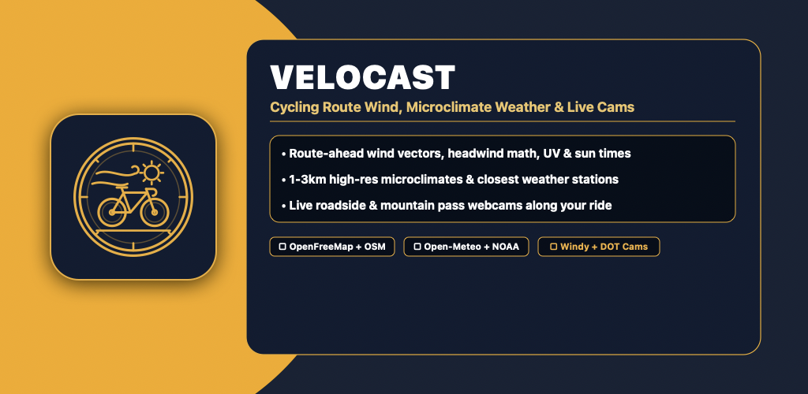

# 🚴 Velocast — Route-Ahead Cycling Wind, Microclimate Weather & Live Cameras

**Velocast** is an Android cycling meteorology and route-planning application engineered to show cyclists the wind, temperature, rain probability, UV index, sunrise/sunset times, closest weather station, and live roadside cameras **where they are riding to**—rather than just where they start.

---

## ✨ Key Features

- **📍 Saved Cycling Places (Home Tab):**
  - Save common cycling climbs, coastal loops, and mountain passes.
  - Displays current & daily high/low temperature, wind speed + gusts + compass arrow, chance of rain (%), UV index with severity badge, sunrise & sunset times, and the **closest physical/grid weather station** with distance and elevation.
  - Expandable **12-hour cycling wind & weather timeline** per spot.
- **🗺️ Plan a Ride (Up to 5 Waypoints & Route Cast):**
  - Add up to **5 route waypoints** by tapping directly on the map or searching addresses/climbs.
  - Calculates estimated arrival times (ETAs) based on departure time and average cycling speed.
  - Computes rider travel bearing vs. forecasted wind direction at each point to classify **🟢 Tailwind**, **🔴 Headwind**, or **🟡 Crosswind**.
- **🛣️ Saved Rides (Temperature & Wind Per Ride):**
  - Save planned cycling routes and view the live forecasted **temperature span per ride**, average wind speed, max rain probability, UV index, sunset time, and point-by-point waypoint breakdown.
- **📷 Public Roadside & Mountain Pass Camera Feeds:**
  - Inspect live roadside snapshots and highway pass conditions near any saved place or route waypoint.

---

## ⚙️ Configurable Free Engines (Options Tab)

1. **Mapping Options (Free & API-Friendly):**
   - **OpenFreeMap (MapLibre Vector)** *(Default)* — GPU-accelerated vector Liberty basemaps (`100% Free`, zero API keys).
   - **OSMDroid (OpenStreetMap Raster)** — Native OpenStreetMap tile rendering with local device caching.
2. **Weather & Microclimate APIs:**
   - **Open-Meteo (1–3km Microclimate)** *(Default)* — Aggregates NOAA HRRR 3km, DWD ICON 2km, and ECMWF models (`10,000 calls/day free`, no API key).
   - **NOAA / NWS Station API** — Pinpoints the closest physical METAR/Mesonet observation station (`100% Free`).
   - **WeatherAPI.com** — Astronomy, UV index & hourly telemetry (optional key + automatic free bridge fallback).
   - **OpenWeatherMap** — Global weather & wind vectors (optional key + automatic free bridge fallback).
3. **Public Camera Feeds:**
   - **Windy Webcams API** *(Default)* — Global scenic, coastal, and mountain pass cycling webcams.
   - **State & Regional DOT 511 Feeds** — Live Caltrans, WSDOT, CDOT & 511 highway/pass camera snapshots.
4. **Selectable App Icons:**
   - **Medusko Gold Contour** *(Default)* & **Classic Neon Cyan**.

---

## 🔗 Links & Contact

- **Website:** [medusko.com](https://medusko.com)
- **Support:** [support@medusko.com](mailto:support@medusko.com)
- **Social:** [@meduskodev](https://twitter.com/meduskodev)
